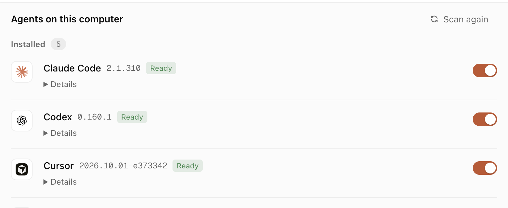
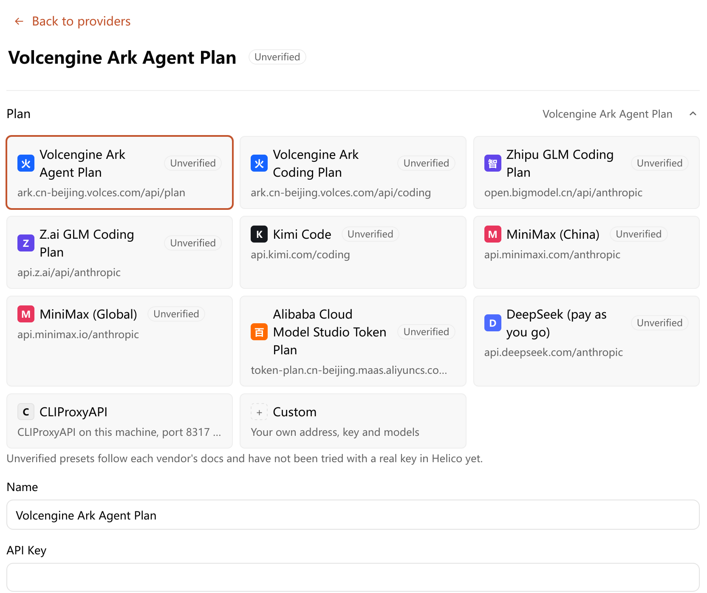
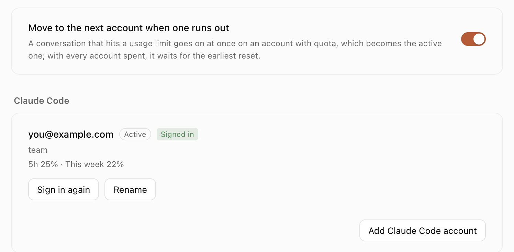
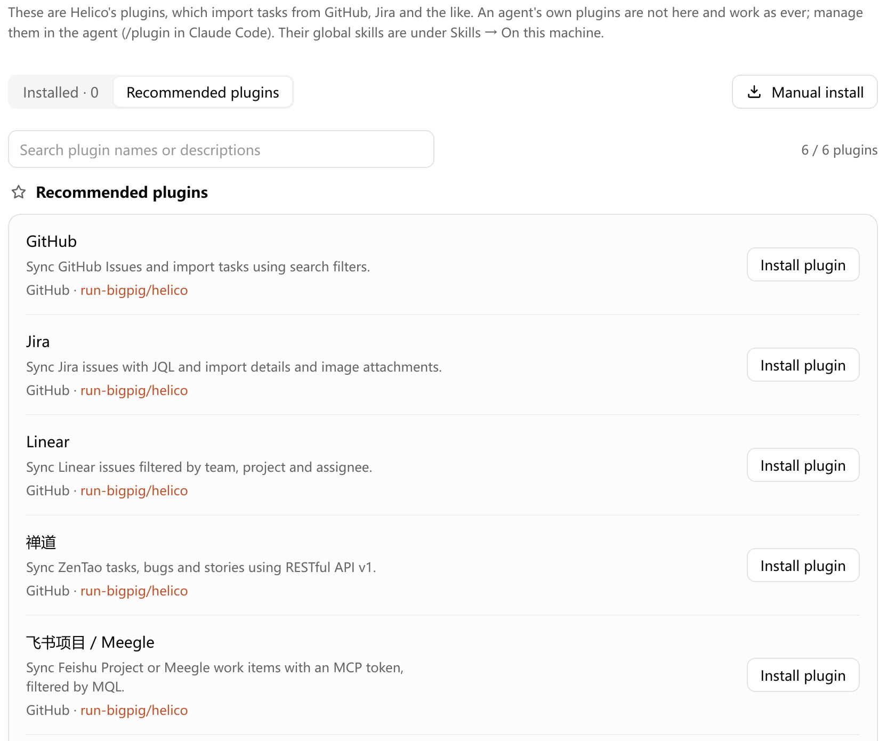
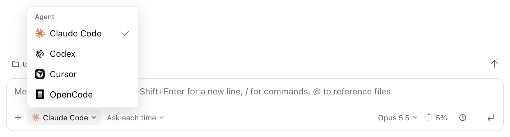
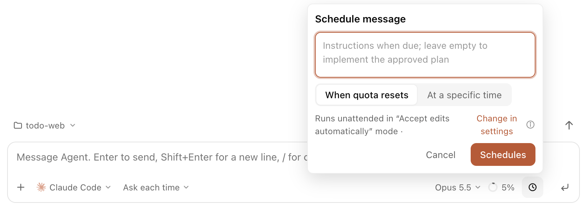
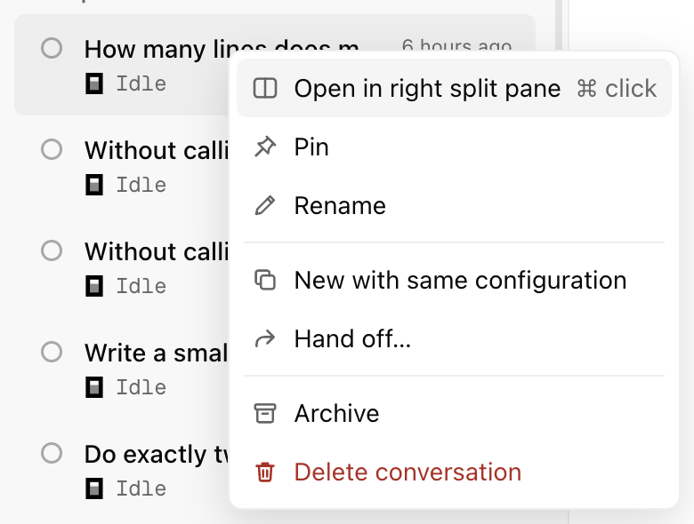
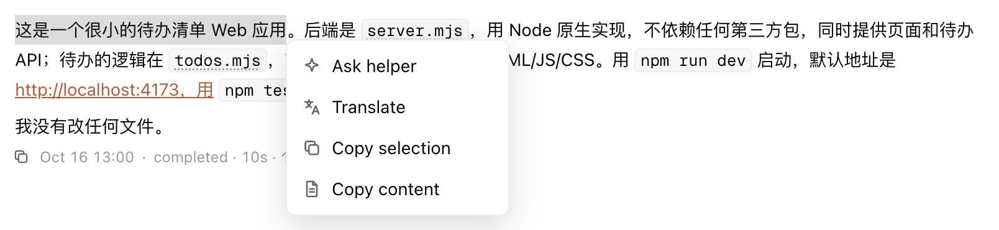
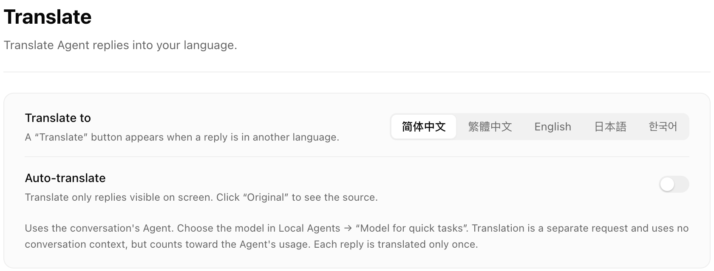

# Helico user guide

Look up configuration and features here when you need them. On first use, the pet checks whether an agent is installed and usable, then asks whether to configure task sources. To check again, open **Help → Check your setup** at the bottom left.

## Agent installation and sign-in

Open [**Settings → External agents**](helico:settings/agents) to check installation, enabled state and readiness. Agents can use their own account or a compatible model provider; the setup check shows what your agent needs.

- To use the agent's own account: run the sign-in command on that row in a terminal, then click **Scan again**.
- Listed under **Available to install**: click **Install in terminal**, or run the install command yourself, then click **Scan again**.
- To use a model provider: configure a compatible provider as described below. If it is already configured in the agent itself, follow the setup check's confirmation prompt.

### Projects and agents live in WSL (Windows)

If you work inside WSL and your agents are installed only in the distro, run helico's backend there too: open **Settings → Backend location** (there only in the installed app on Windows), choose that distro under Run on, and helico restarts. From then on, choosing a project shows the distro's folders, and helico uses the git and agents inside it.

- Use an x64 or arm64 WSL 2 distro. helico deploys its Go backend along with Node.js, npm, and npx exclusively for Node MCP. If deployment fails, helico uses the local backend and shows the reason in Backend location settings.
- Each place has its own tasks, conversations and settings, separate from the other's; switching back brings the earlier ones back.
- Keep Awake requires the local backend.

## Model providers

**Skip this when the agent uses its own account.** Add one for a coding plan such as Volcengine Ark, Zhipu GLM or Kimi, or to let OpenCode, Pi or DeepSeek Harness answer.

In [**Settings → Model providers**](helico:settings/model-providers), click **Add provider**: pick a plan, paste the API key, tick the agents that use it, and click **Save and test**. A ✓ on every line means it works. Cursor cannot use a provider.

Pick it in the **Provider** control of the input box when starting a conversation. It bills the provider's plan, not the agent's quota, and cannot be changed once the conversation has started.

**A local proxy (CLIProxyAPI and the like)**: pick **CLIProxyAPI**; its addresses are filled in for the default port 8317. Use one of the keys under `access.api-keys` in its config, then click **Fetch models from the endpoints**. For another proxy pick **Custom**: Claude Code needs the Anthropic endpoint, Codex the Responses endpoint, and OpenCode takes any. Where the endpoint does not say how large a model is, enter its real limits in the **Context** and **Max output** columns of the model table; tick **Images** for a model that reads them.

Using Claude, Gemini or other subscription accounts through a proxy may break their terms and get them banned, more so when left running unattended or with several conversations at once. CLIProxyAPI keeps helico's own small requests, such as titles and translations, off it by default (**Titles, translations and commit messages**); if the proxy tells clients apart by their headers, set them under **Extra request headers**.

## Multiple accounts

**Optional,** for Claude Code and Codex only.

In [**Settings → Accounts**](helico:settings/accounts), click **Add Claude Code account** (or Codex), then **Add and sign in**, finish in the terminal below and click **Make active**. When an account runs out, the conversation moves on to the next one by default.

## Task sources

Install a source plugin to sync external work items to your inbox.

1. In [**Settings → Plugins**](helico:settings/plugins), click **Install plugin**.
2. Open **Settings → Integrations → the source's name**, fill in the site and filters, click **Sign in** with your token, and turn on **Sync to inbox**.
3. In **Inbox** in the sidebar, click **Sync now**, then **Import task** on an issue.

| Source | What you need |
|---|---|
| GitHub | Personal access token and a search query (add `label:bug` for bugs only) |
| Jira | Site, sign-in email, API token and JQL |
| Linear | Personal API key |
| ZenTao | RESTful API v1 URL (such as `https://zentao.company.com/zentao/api.php/v1`), token and product ID |
| PingCode | Project ID and personal access token with the `pcp:read:pjm:workitem` scope |

Use the default API URL for PingCode Cloud. For self-hosted PingCode, enter `https://your-domain/open/v2`. If you know a work item number, fetch that work item through the API and copy its `project.id`. Each source instance syncs one project and can filter by assignee, type, and state. [PingCode REST API](https://open.pingcode.com/)

For a platform outside the recommendations, use **Install from another source** with a GitHub repository or a local ZIP. To write your own, see the Go plugin SDK.

## Let colleagues ask on Slack, Feishu or DingTalk

Put an agent on Slack and colleagues can mention it in a channel. It answers from the projects you pick: where a feature lives, what an error means. It changes no code and reaches nothing else on this computer.

1. On the **Agents** page create an agent, pick **On a chat platform** at the top, say in its Instructions what it answers and how long its answers run, and save. Such an agent answers only on chat platforms: it has no skills or MCP servers to set and does not appear in your own conversations or delegations.
2. **Chat platforms** now shows below. Click **Add Slack** and follow the five steps:
   - Open Slack's app page, choose **Paste a manifest**, paste the manifest helico gives you, create the app and install it to the workspace.
   - Enter two tokens: the App-Level Token (Basic Information → App-Level Tokens, scope `connections:write`) and the Bot User OAuth Token (OAuth & Permissions).
   - Pick the projects it may read. It reads only files of Git repositories that `.gitignore` does not ignore; files like `.env` and keys are withheld.
   - Enter the member IDs and channel IDs that may ask. Anyone else only gets “no access”.
   - Set how many questions each person, and everyone together, may ask a day.
3. Once the state reads “Connected”, `/invite` the app to the channel and mention it. It marks the message with 👀 and answers in a thread under it; mention it again to go on. Screenshots are read, other files are not.

Worth knowing:

- With no model provider picked for the agent, colleagues' questions spend your current Claude Code account.
- Questions asked while the computer is off or asleep are not received, and the platform does not send them again.
- When someone else asks in the same thread, it does not remember what the first person asked: each has a context of their own.
- Who asked what, which files it read and what it answered are all under **Questions** in the same place.

### On Feishu

The steps are the same; click **Add 飞书**. What differs is making the app and finding IDs:

- In the Feishu developer console, create a custom app and add the Bot feature. Under Permissions & Scopes → Batch import/export scopes, paste the scopes helico gives you, then publish a version.
- Enter the App ID and App Secret from Credentials & Basic Info and save. Once the state reads “Connected”, go back to Events & Callbacks in the console, choose to receive events through a persistent connection, add the Message received event, and publish another version. Feishu saves a persistent connection only once one is open, so save in helico first.
- Feishu shows member IDs and group IDs nowhere. Add the bot to the group and have the colleague mention it once: anyone not yet allowed gets a reply with their ID (starting `ou_`) and the group's (starting `oc_`) to put on the allow list.
- In a group it answers as a topic; mention it again inside the topic to go on.

On Lark, Feishu's international edition, click **Add Lark**: the steps are the same as Feishu's, with the app made in the Lark developer console (open.larksuite.com).

### On DingTalk

The steps are the same; click **Add 钉钉**. What differs:

- In the DingTalk developer console, create an internal app, add the Robot feature with Stream mode as its message receiving mode, and publish the robot. Under Permissions, apply for the permission to send messages as an internal robot (it is needed to read screenshots and to answer slowly), then publish a version.
- Enter the Client ID and Client Secret from the app's credentials and save; wait for “Connected”.
- Member IDs are the userIds of the address book, shown in a member's details in the admin console. Group IDs (starting `cid`) are shown nowhere: have the colleague mention the robot once and take them from the “no access” reply.
- A DingTalk robot can neither answer in a thread nor add 👀: its answer is a new message in the group that mentions the asker, and each mention is a new question that does not remember the last. In a direct message it remembers what came before.

## Features

Look up these features when the relevant situation comes up.

### Handoff

Out of quota, or want another agent to carry on? Click the agent's name at the bottom left of the input box, pick another, add a note and click **Hand off**. The new agent gets the chat history and keeps working in the same folder.

### Cross-conversation references

To build on an earlier discussion, type `@` in the composer, select **Conversations**, and find one by title, project, or agent. Select it and describe what to do. The current agent can read the referenced history as needed and keeps working in its current folder. Click a referenced title in a sent message to open the original conversation.

The Conversations category requires **Let Agents read your helico records** in [Settings → Permissions](helico:settings/permissions). Enabling provides the reading tools from the agent's next start; disabling blocks reads immediately. Handoff changes the agent working on the current conversation; a conversation reference adds source material.

### Scheduling: send when quota resets, or at a set time

1. Write your message in the input box.
2. Click the **clock** button at the bottom right of the input box.
3. Choose **When quota resets** or **At a specific time**.
4. Confirm.

| You can also schedule | Where |
|---|---|
| A task | The clock button on the task's toolbar |
| Approving a plan | **Schedule approval** on the plan card |
| View, reschedule or cancel | "N schedules" in the status bar, or **Up next** in the Overview |

When it is due, the agent runs unattended in the mode shown in the popover; **Change in settings** picks another. Nothing runs while the computer sleeps; turn on **Keep computer awake** from the coffee cup in the status bar.

### Split view: two conversations side by side

| To | Do this |
|---|---|
| Open a split | Right-click another conversation → **Open in right split pane**; or ⌘-click it; or drag it onto the chat |
| Move focus | ⌘1 for the left pane, ⌘2 for the right |
| Resize | Drag the divider between them |
| Put away / bring back | ⌘\ |

Each side has its own input, progress and approvals.

### Helper and translation

Select part of a reply and right-click:

- **Ask helper**: opens on the right with a light model and its own context, to explain or dig in without touching the main conversation.
- **Translate**: translates just the selection. When a reply is in another language, a **Translate** button under it translates the whole reply.

| Setting | Where |
|---|---|
| Language to translate into, auto-translate, model used for translation | [**Settings → Conversations**](helico:settings/conversation) |

### Also worth knowing

| Feature | How |
|---|---|
| To-dos | Agents note what you need to do later; tick them off in the inspector's **To-dos** tab |
| Conversation groups | **Group and sort** on the sidebar's **Conversations**: by project, agent or run status |
| Keeps running | Agents run in a background process; closing the window does not stop them |

You can open this guide any time from **Help → User guide** at the bottom left.
